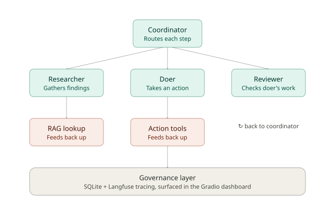

# Agent Governance & Cost Observability Platform

A multi-agent system built with LangGraph that researches a task, takes
action on it, and reviews its own work — while every step is logged,
costed, traced, and evaluated for governance and observability purposes.

Live demo:(not responding, will make a demo local video) https://governance-platform.ashysmoke-a043016a.westus2.azurecontainerapps.io/

## What it does

Given a task (e.g. *"Research agent governance principles, then write a
summary file"*), the system:

1. **Coordinates** — a router agent decides which specialist should act next.
2. **Researches** — a research agent pulls relevant context from a
   ChromaDB knowledge base (5 governance documents, embedded with Gemini)
   via a `retrieve_governance_knowledge` tool.
3. **Acts** — a "doer" agent takes a concrete action based on the research
   (via `write_file_stub` or `send_notification_stub` — stubbed tools that
   simulate real side effects for demo purposes).
4. **Reviews** — a reviewer agent checks whether the action is actually
   supported by the research and well-targeted at the task. If not, it can
   send the doer back to revise once (bounded — no infinite loops).

Every LLM call and tool call is logged to SQLite with token counts, cost,
and latency, and (optionally) traced in Langfuse. A Gradio dashboard
surfaces cost ranking, tool usage, error rates, anomaly detection, eval
suite results, and a bounded-autonomy escalation check.

## Architecture



Built with LangGraph (`agent/graph.py`, `agent/nodes.py`), a Gemini LLM
(`gemini-3.5-flash-lite`) with `.bind_tools()` and `.with_retry()` for
resilience, and a Gradio dashboard (`app.py`) reading from SQLite.

## Tech stack

- **Orchestration**: LangGraph + LangChain
- **LLM**: Google Gemini (`gemini-3.5-flash-lite`), via `langchain-google-genai`
- **RAG**: ChromaDB with Gemini embeddings (`gemini-embedding-001`)
- **Tracing**: Langfuse (optional — app runs fine without it)
- **Storage**: SQLite (runs, events, eval results)
- **Dashboard**: Gradio
- **Deployment**: Docker → Azure Container Registry → Azure Container Apps

## Running locally

```bash
export GEMINI_API_KEY=your-key-here
# optional:
export LANGFUSE_PUBLIC_KEY=your-key
export LANGFUSE_SECRET_KEY=your-key

pip install -r requirements.txt
python app.py
```

Dashboard opens on `http://localhost:7860`.

## Running with Docker

```bash
docker build -t governance-platform:v1 .
docker run -p 7860:7860 -e GEMINI_API_KEY=your-key-here governance-platform:v1
```

## Running the eval suite

```bash
python -c "from agent.eval import run_eval_suite; run_eval_suite()"
```

Runs all 12 test cases through the full graph and scores them on three
layers: structural (did it produce findings + an action?), rule-based
(does the output mention expected keywords?), and LLM-judge (1-5 rating
from Gemini). Results are saved to `eval_runs` and visible in the
dashboard's **Eval Suite Results** tab.

## Known limitations

- **tc12 tool-selection defect**: during Week 15 regression testing, test
  case `tc12` ("notify the team about monitoring needs") intermittently
  had the doer agent call `write_file_stub` instead of the expected
  `send_notification_stub`. Investigation confirmed this is a genuine
  tool-selection inconsistency in the LLM's choice, not eval-judge noise —
  the model sometimes conflates "notify" with "document." Logged as a
  known issue rather than fixed, given the Week 16 deployment deadline.
  A fix would likely involve tightening the doer's system prompt to
  disambiguate the two tools' triggering conditions.
- **Ephemeral state**: the SQLite database is created fresh inside the
  container on every startup and is not persisted to durable storage.
  This means **all run history, cost data, and eval results reset on
  every redeploy or container restart** — by design for this demo (see
  project notes), but a production deployment would mount a persistent
  volume or switch to a managed database (e.g. Azure SQL or Postgres).
- **Langfuse is optional**: if `LANGFUSE_PUBLIC_KEY` / `LANGFUSE_SECRET_KEY`
  aren't set, the app runs normally and just skips external tracing —
  SQLite logging (and the dashboard) work independently of Langfuse.

## Deployment notes

Deployed via: Docker image built locally → pushed to Azure Container
Registry (`governanceacr16.azurecr.io`) → deployed to Azure Container
Apps with external ingress on port 7860. (Cloud-side `az acr build` was
blocked by Azure's ACR Tasks restriction on new Free Trial subscriptions;
building locally and `docker push`-ing directly to ACR bypassed this.)
